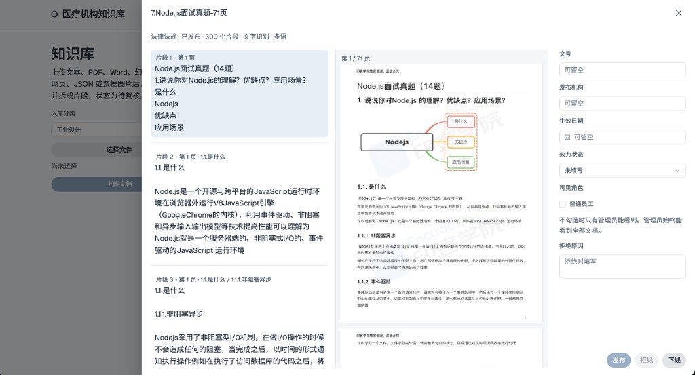
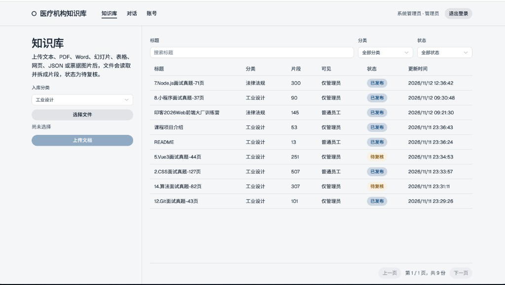
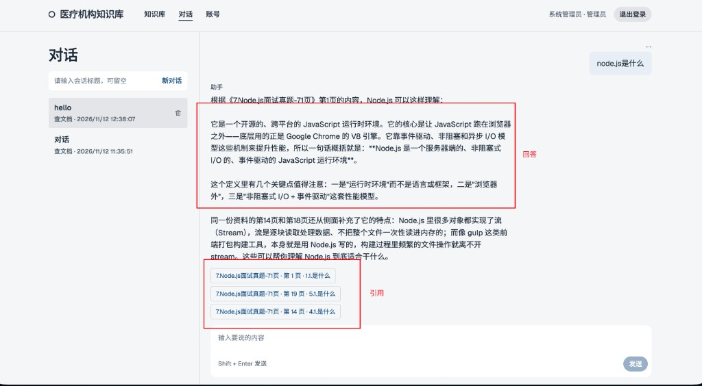
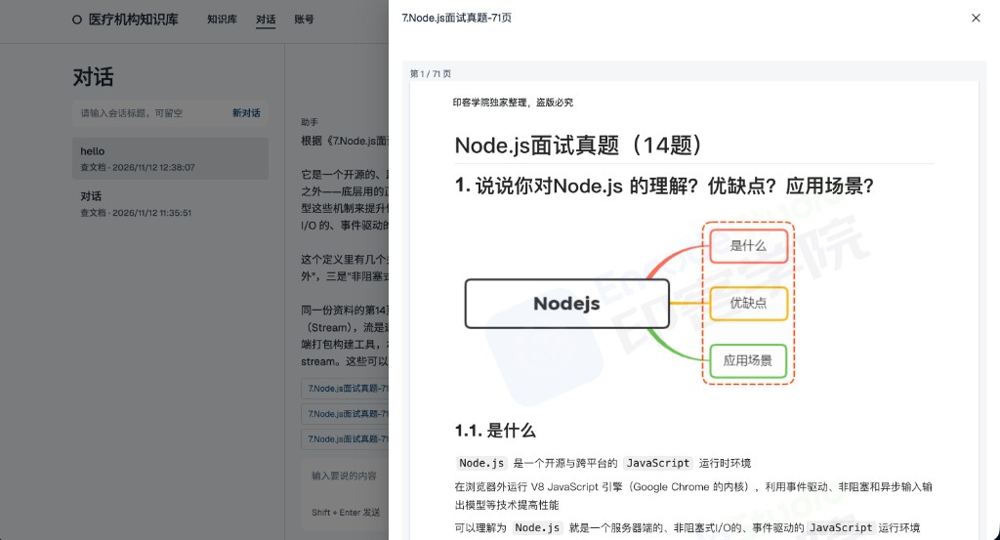

# 医疗机构知识库：实现说明

这是一套知识库问答演示。文档入库后按结构拆成片段，管理员发布后才写入向量。对话时按问题检索已发布原文，交给对话模型流式作答，并给出可打开的原文页码。

## 技术组成

- 前端：Vue 3、Vite、Element Plus。
- 后端：FastAPI、SQLAlchemy、Alembic。
- 数据库：PostgreSQL + pgvector。
- 向量：本地 `BAAI/bge-small-zh-v1.5`，512 维，fastembed。
- 对话：OpenAI 兼容的 `/chat/completions`，流式返回。
- 文字识别：本地 RapidOCR，不调用云端识别接口。

## 文档解析

单文件不超过 20MB。相同 SHA-256 再次上传会跳过。支持 `txt`、`md`、`pdf`、`docx`、`pptx`、`xlsx`、`xls`、`csv`、`tsv`、`html`、`htm`、`json`、`png`、`jpg`、`jpeg`、`webp`、`tif`、`tiff`。

| 格式 | 做法 |
| --- | --- |
| txt / md | 按纯文本或 Markdown 读取。`#` 标题保留层级 |
| pdf | pdfplumber 取文字层、表格和行坐标。`(cid:)` 达到 3 处，或正文很短且没有表格，则整页渲染后用 RapidOCR。其余页走版面解析，不因为一两个乱码字符整页重识别 |
| docx | 读取标题、段落、列表、表格、题注和脚注 |
| pptx | python-pptx。按幻灯片取形状、表格、图表标题和演讲者备注。一页对应一张幻灯片 |
| xlsx / xls / csv / tsv | 每个工作表单独成页。第一行非空行当表头。xlsx 同时保留缓存值和公式。隐藏表会标明 |
| html | BeautifulSoup。去掉 script、style、导航和页脚，保留标题、段落、列表、表格和代码 |
| json | 标准库解析。按路径展开，标量写成「键：值」，对象和数组项作为记录 |
| 图片 | RapidOCR。能匹配到发票号码、开票日期、购买方、销售方、金额、税额时写成票据字段。识别不到的字段不补 |

读不出文字的文件记为已拒绝。能读出文字的进入待复核。

## 拆分方式

先识别结构，再按长度打包。默认一块约 800 字，重叠约 120 字（大约 10%–20%）。固定长度只用来截断过长的正文。

一页先分成这些块：标题、段落、列表、表格、代码、公式、脚注、图注、记录。

- 表格、代码、公式、脚注、图注、记录各自成块，不和前后正文揉在一起。
- 表格被长度截断时，每一块都重复表头和分隔行。
- 图注紧挨着的表格会先并到这张表上。
- 「但是、然而、不过、否则、除外、因此、所以」这类连接句留在前一块，最多放到 1.5 倍长度。
- 公式和后面的「其中 / 式中」留在同一块，脚注不并进公式。
- 列表和它前面的引导句留在一起。

正文超过长度时才切开。重叠优先带走末尾若干完整的段落或列表项；带不走时，才考虑最后一句，而且这一句本身不能是连接句。重叠放不下时，下一块只重复章节路径，不再硬抄上一块的半句话。

每一块正文前面写上当前章节路径，例如「1.2 版本管理 / 1.2.4 CVS」。页码取这块正文开始的那一页，`page_end` 取正文结束的那一页。相邻块记下上一块和后一块，较短章节路径的那块记为父块。

同时保存抽取方式、语言（中文、英文或中英混合）、OCR 平均置信度、区域坐标。页面上的结构化块也入库，之后重切不必重新识别。OCR 置信度低于 0.75 时，片段打上「识别置信度偏低，数字和名称需要复核」。

改切分参数不会自动重切已经入库的文档。

打开文档时，左侧是按上述规则切出的片段，右侧是同一页的原文。下面这份 Node.js 面试题的第 1 页，片段 1 对应封面和总问题，片段 2 对应「1.1 是什么」。

## 发布和权限

状态实际会用到的是：待复核、已发布、已拒绝、已下线。已发布的文档只能下线。

发布时才为缺失片段计算向量，向量文本是「文档标题 + 页码 + 片段序号 + 正文」。写入成功后才把状态改成已发布。写入失败则状态不变。拒绝或下线删除该文档的全部向量。

角色只有管理员和普通员工。发布时可以勾选普通员工是否可见；不勾选则仅管理员可检索、可打开。普通员工还能看到自己上传的文档。管理员可以看到全部文档和全部对话。

向量存在 `chunk_vectors`，一条片段一行。`embedding` 上有 HNSW 余弦索引，`document_id` 上有普通索引。

知识库列表可以按标题、分类和状态筛选。下图里「7.Node.js面试真题-71页」和「5.Vue3面试题-44页」是待复核，其余为已发布。可见范围为「仅管理员」或「普通员工」。

## 检索

查文档和出方案会检索。问候、道谢、道别，以及「你是什么模型」这类问题不检索。

问句用和入库片段同一套模型编码，不加检索前缀。距离用余弦距离，越小越近。

1. 在当前角色可见的已发布片段里，取向量最近的 12 条。
2. 问句里的英文专名（长度不少于 3，或带数字，或全大写且不少于 2 个字母）再按原文做不区分大小写的包含匹配，最多补 8 条，不与前面重复。
3. 正文命中专名的片段，排序距离减 0.22。
4. 最好的一条调整后距离大于 0.50，整组丢弃。其后条目比最好的远 0.10 以上，或原始距离大于 0.68，停止。最多留下 4 条交给模型。

## 对话

对话模型通过 `CHAT_BASE_URL/chat/completions` 调用，请求体为 `model`、`messages`、`temperature: 0.3`、`stream: true`。返回按 `data:` 事件流解析，只取 `choices[0].delta.content`。

查文档时，提示词要求只根据这几条已发布原文作答，并在回答里带上文档名和页码。原文不足时要说明资料里没有。出方案同样把原文交给模型。

同一次会话里，最近大约 1.2 万字的对话原样交给模型。单条超过 4000 字，或更早、放不下的记录，会先调用对话模型压成摘要再放进这次请求。摘要只给模型用，页面仍显示完整消息。压缩失败时，退回为只保留放得下的最近对话。模型整段返回成功后才写入用户消息和助手消息。调用失败或空回复不保存。助手消息上保存引用，点击后按页码打开原文件。

第一条消息会把标题为「新对话」的会话改成这句的前 24 个字。

问「node.js是什么」时，回答依据已发布的《7.Node.js面试真题-71页》，并在下面列出可点击的引用。

点击引用后，按页码打开原文件。下图打开的是该文档第 1 页。

